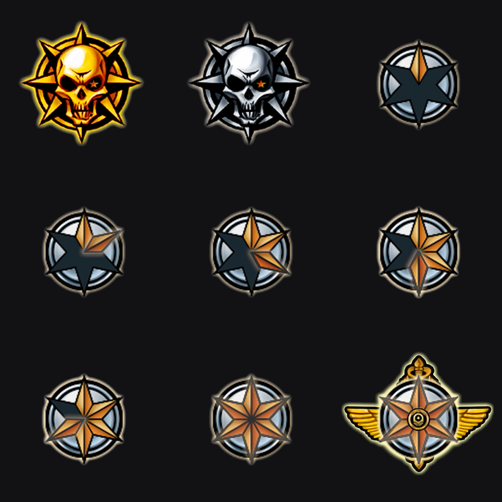
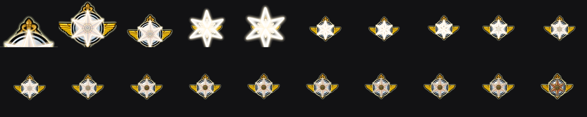

# Kill Streak — PAYDAY The Heist

击杀图标 + 击杀语音模组，把 PAYDAY 2 的 *KillStreak* 效果移植到 PAYDAY The Heist。

Kill-confirm icons (with per-streak frame animation) and kill-confirm voice lines for PAYDAY: The Heist, ported from the PAYDAY 2 mod *KillStreak* by **Eysent**.



---

## 效果

- **9 档图标**：1 杀金色爆头 / 1 杀爆头 / 1 杀身体 / 2~7 连杀。星角随连杀一个个点亮，6 连杀是完整六角星，7 连杀带金色翅膀，爆头是骷髅。
- **逐帧动画**：每档 20 帧、60fps，入场白光爆闪 → 落定 → 停留 → 淡出。播完自动切到单独的高清层，放大后不糊。
- **击杀语音**：9 个角色语音包，可随机，也可换成自己的 wav。
- **可调**：图标大小 / 透明度 / 水平垂直位置、动画与停留时长、连杀中断时间、语音音量。
- **三语菜单**：中文 / English / Русский，跟随游戏或手动指定。



---

## 安装

**前置：游戏已安装 [DAHM](https://modworkshop.net/mod/33994) 模组框架**（本仓库不含框架）。确认游戏目录下存在：

```
PAYDAY The Heist\mods\init.lua
PAYDAY The Heist\mods\core\setup.lua
```

然后：

1. 完全退出游戏（退到桌面，不是退回主菜单）。
2. 把 `mods/killstreak` 整个文件夹复制到游戏的 `mods` 目录：

   ```
   PAYDAY The Heist\mods\killstreak\base.lua
   ```

   **注意别套成** `mods\killstreak\killstreak\base.lua`（多一层就加载不到）。
3. 启动游戏。

**不需要**放进 `assets\mod_overrides`。PDTH 那个通道只能覆盖游戏已有资源，加不了新纹理，本模组的贴图全部自己注册。

设置菜单位置：主菜单 → 选项 → 模组 → **KILL STREAK**。

详细的安装、设置项、故障排查见 [`使用说明.txt`](使用说明.txt)。

---

## 文件结构

```
mods/killstreak/
├─ base.lua          模组定义 + 默认配置
├─ config.lua        设置项声明
├─ main.lua          图标面板、20 帧动画、连杀状态机、音效派发、贴图注册
├─ copdamage.lua     击杀判定(hook CopDamage 伤害函数 + EnemyManager 兜底)
├─ hudmanager.lua    关卡生命周期(换关重建 overlay gui 时重建面板)
├─ modoptions.lua    设置菜单(三语表 + 角色名映射)
├─ extsound.lua      外部播放器:队列文件、心跳、音量、静默启动
├─ sfx/              9 个语音包 × 10 个 wav(1ch / 22050Hz / 16bit)
├─ assets/           killicons_a/b/c.texture(2048²) + killicons_hi.texture(2048×1536)
└─ tools/            sfx_launch.vbs(静默启动) + sfx_server.ps1(常驻播放服务)
```

仓库其它部分：

```
README.md                    本文件
使用说明.txt                  给玩家的安装/设置/排错说明
docs/                        效果截图
patches/objecthooker/        防闪退补丁(DAHM 旧版才需要)
```

---

## 为什么需要外部播放器

PDTH 的音频引擎是 Wwise，**只能播放预先编译进 soundbank 的事件**，没有加载外部音频的接口——这也是社区一直没有 hitsound 类模组的原因。

所以击杀语音由 Windows 自己播：

```
Lua  → tmp/queue.txt(追加一行)  → PowerShell 8ms 轮询 → SoundPlayer
     ← tmp/server.heartbeat(每 2s 写时间戳)
     ← tmp/volume.txt(整数百分比)
```

`tools/sfx_launch.vbs` 用 `wscript` 静默拉起 `tools/sfx_server.ps1`，全程无窗口。**只在游戏启动时拉起一次**，之后靠心跳文件判断存活并复用，换图不会重复启动。

延迟约 15~30ms（4 实例预加载播放池）。游戏退出后助手进程自行结束，不会残留。

> 杀软误报说明：这个设计包含「隐藏窗口 + 常驻进程 + 文件通信」，行为模式和恶意软件有相似之处。源码全部可读，`tools/sfx_server.ps1` 只有播放逻辑、音量缩放、心跳和自退出。若不放心，可把 `sfx_mode` 改成 `wwise` 只用游戏内置音效，或直接删掉整个 `tools/` 目录（模组仍能显示图标）。

---

## 已知问题

- **击杀后闪退**：DAHM 早期版本的 `objecthooker.lua` 在 hook 递归超过 256 层后不会中断，导致 Lua 栈溢出。补丁见 [`patches/objecthooker/`](patches/objecthooker/)，把里面的 `objecthooker.lua` 覆盖到游戏的 `mods/core/objecthooker.lua`，原文件已备份为 `objecthooker.lua.orig`。**DAHM 新版已修复此问题的不需要打补丁**，覆盖前先确认版本。
- **没有声音**：先看 `logs/main.log` 里有没有 `external sound helper started`。没有说明助手进程没起来，检查杀软是否拦截了 `wscript` 启动 `powershell`。
- **图标不显示**：确认 `logs/main.log` 里有 `texture registered from ...`。

---

## 兼容性

- 游戏：PAYDAY The Heist（Steam 版）
- 框架：DAHM 1.18.1.1 / hook rev16 开发与测试，理论上兼容其它 DAHM 版本
- 与其它 HUD 模组共存：本模组只 hook `CopDamage` 的伤害函数与 `HUDManager`，不替换原版函数

---

## 致谢

- **Eysent** — PAYDAY 2 原版 *KillStreak* 模组，图标设计与判定逻辑的来源
- **DAHM / DorHUD** 的作者们 — PDTH 的模组框架与逆向文档
- 图标美术、语音素材由本仓库作者整理制作

## 版权

代码可自由修改、复用。图标为本项目自制素材；语音包来自游戏原声，仅作自用与同好分享，**请勿用于商业用途**。如相关权利方有异议，会立即移除相应素材。
